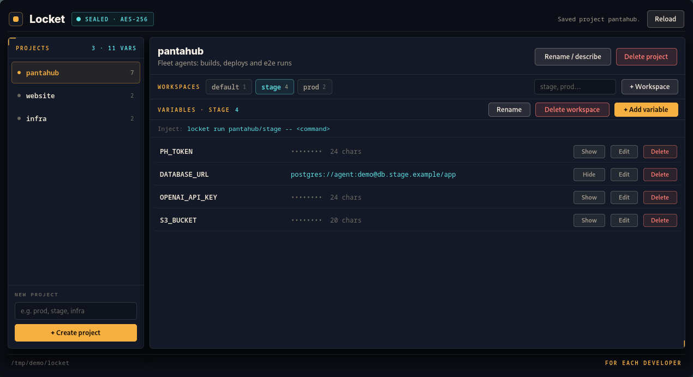
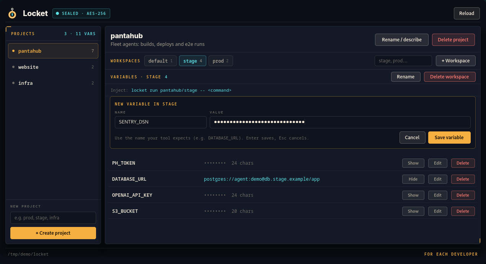
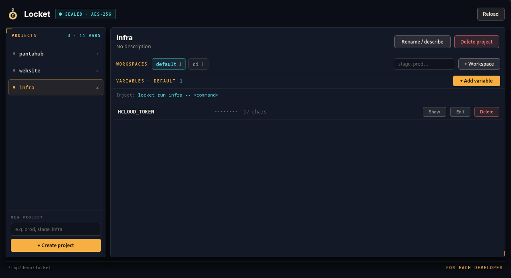
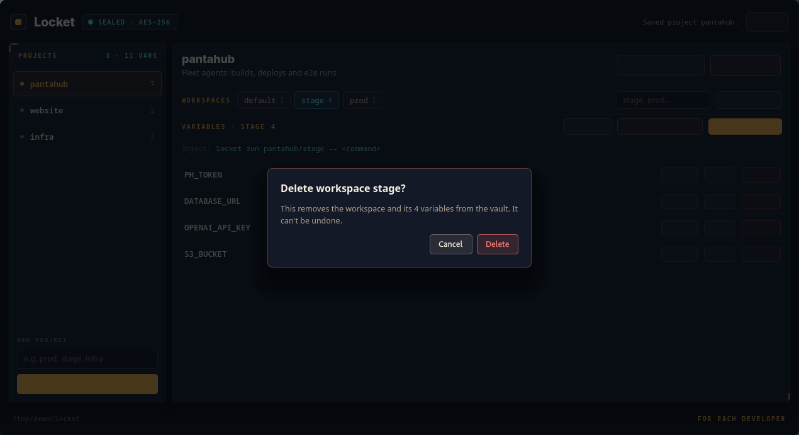
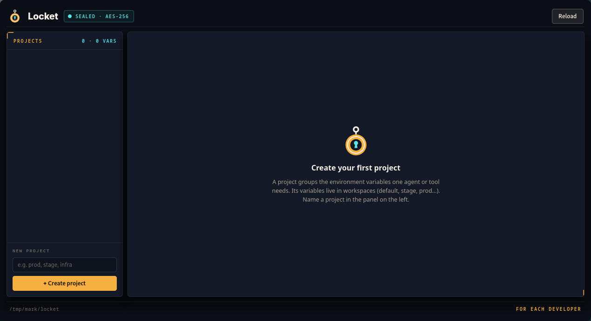

<p align="center">
  
</p>

<h1 align="center">Locket</h1>

<p align="center">
  A local secrets vault for AI agents.<br>
  Give an agent the environment it needs without the values ever reaching
  the chat, the logs, <code>ps</code> or your shell history.
</p>

<p align="center">
  <a href="https://locket.foreachdeveloper.com">Website</a> ·
  <a href="https://github.com/highercomve/locket/releases/latest">Download</a> ·
  <a href="CHANGELOG.md">Changelog</a>
</p>

<p align="center">
  
</p>

Locket keeps your API keys, tokens and connection strings in one
AES-256-GCM–sealed file on your machine, organised as **projects →
workspaces → variables**. When an agent (or you) needs them, it runs:

```sh
locket run pantahub/stage -- ./deploy.sh
```

`deploy.sh` starts with `PH_TOKEN`, `DATABASE_URL` and the rest of
`pantahub/stage` in its environment. Locket prints only which workspace
it used and how many variables it injected. An agent can be told to run
that command without ever being shown, or asked to paste, a secret.

Two programs share one core and one vault file:

- **`locket`**, the command line: small, static, with no GUI libraries.
- **`locket-app`**, the desktop window, built on
  [Oriel](https://github.com/highercomve/Oriel)'s renderer: compiled
  `.oriel` views driven from Zig, no web view, no JavaScript.

Both are written in Zig 0.16, for Linux, macOS and Windows, and both
update themselves from the GitHub releases.

## Contents

- [Install](#install): [download](#download), [updates](#updates), [from source](#from-source)
- [Projects, workspaces, variables](#projects-workspaces-variables)
- [The command line](#the-command-line)
- [The desktop app](#the-desktop-app)
- [Using it with agents](#using-it-with-agents)
- [Sharing between machines](#sharing-between-machines)
- [Safety](#safety)
- [On disk](#on-disk)
- [Development](#development)

## Install

### Download

Every [release](https://github.com/highercomve/locket/releases/latest)
has the app and the command line for each platform, with a `SHA256SUMS`
file:

| Platform | The app | The command line |
|---|---|---|
| Linux x86_64 | `locket-app-<version>-x86_64.AppImage` (updates itself), or the `.deb` / `.rpm` (both include `locket`) | `locket-<version>-x86_64-linux` (static) |
| Linux aarch64 | | `locket-<version>-aarch64-linux` (static) |
| macOS (Apple silicon) | `Locket-<version>-macos-arm64.dmg` | `locket-<version>-aarch64-macos`, `-x86_64-macos` |
| Windows x86_64 | `Locket-<version>-setup.exe` (per user, no admin) | `locket-<version>-x86_64-windows.exe` |

Put the command line on your `PATH` as `locket` (for example
`~/.local/bin/locket`, `chmod +x` it). The builds aren't signed by Apple
or Microsoft yet: on macOS, open the app the first time with right-click
→ **Open**; on Windows, SmartScreen asks once (**More info** → **Run
anyway**).

### Updates

```sh
locket --version        # locket 0.1.0 (<commit>)
locket update --check   # is there a newer release?
locket update           # download, verify and install it
```

The app checks when it starts: when a newer release is out, an **Update
to …** button appears next to its version; it installs the update, then
**Restart to update** runs it. Every update is checked against an
Ed25519 signature built into Locket and the file's SHA-256 before
anything is replaced. A deb or rpm install is updated by your package
manager instead.

The app and the command line update together. The app's update also
updates the `locket` in the same folder, and `locket update` also
updates the `locket-app` AppImage (or `locket-app.exe`) in its folder.
A newer Locket can store the vault in a format an older one can't read,
so the two shouldn't drift apart. On macOS, the command line inside the
`.app` updates with it.

### From source

You need [Zig 0.16](https://ziglang.org/download/) and, for the desktop
app on Linux, the GTK 4 development files (`gtk4` on Arch,
`libgtk-4-dev` on Debian and Ubuntu, `gtk4-devel` on Fedora).

```sh
git clone https://github.com/highercomve/locket
cd locket
scripts/install-local.sh
```

On Linux that builds both programs (ReleaseSafe) and installs them for
your user:

| Path | What |
|---|---|
| `~/.local/bin/locket` | the command line |
| `~/.local/bin/locket-app` | the desktop app (an AppImage) |
| `~/.local/share/applications/com.foreachdeveloper.locket.desktop` | its launcher entry |
| `~/.local/share/icons/hicolor/*/apps/com.foreachdeveloper.locket.png` | its icons |

It stops a running `locket-app`, replaces it and starts the new one. Run
it again to update from your checkout. Options:

```sh
NO_RESTART=1 scripts/install-local.sh   # leave the app stopped
NO_APP=1 scripts/install-local.sh       # only the command line (no GTK needed)
NO_DESKTOP=1 scripts/install-local.sh   # no launcher entry or icons
ORIEL_FORK=~/Code/oriel scripts/install-local.sh   # build against a local Oriel
```

The install never touches your vault. Make sure `~/.local/bin` is on
your `PATH`.

## Projects, workspaces, variables

A **project** (`pantahub`) groups what one agent or tool needs. Its
variables live in **workspaces**, one per environment (`pantahub/stage`,
`pantahub/prod`). Every project has a **`default`** workspace, which comes
first and can't be renamed or removed: a project "without workspaces"
keeps its variables there, and leaving the workspace out of an address
means it.

| Address | Means |
|---|---|
| `pantahub` | the project, or its `default` workspace (for `run`) |
| `pantahub/stage` | the `stage` workspace |
| `pantahub/API_URL` | `API_URL` in `pantahub/default` (for `set`, `get`, `rm`) |
| `pantahub/stage/DATABASE_URL` | `DATABASE_URL` in `pantahub/stage` |

Names are 1–128 bytes with no spaces, `/` or control characters.
Variable names can't contain `=` either, because they become environment
variables.

## The command line

```sh
# Store a variable. The value comes from stdin, so it's never in argv
# (visible in `ps`) or in your shell history.
printf '%s' "$TOKEN" | locket set pantahub/stage/PH_TOKEN
locket set pantahub/API_URL < api_url.txt          # into pantahub/default

locket ls                          # projects
locket ls pantahub                 # its workspaces
locket ls pantahub/stage           # a workspace's variable names
locket get pantahub/stage/PH_TOKEN # prints one value (use sparingly)

locket rm pantahub/stage/PH_TOKEN      # one variable
locket rm --workspace pantahub/stage   # a whole workspace
locket rm --project pantahub           # a whole project
```

A session with the demo vault from the screenshots:

```console
$ locket ls
pantahub  (3 workspaces, 7 secrets)
website  (2 workspaces, 2 secrets)
infra  (2 workspaces, 2 secrets)
$ locket ls pantahub
pantahub/default  (1 secret)
pantahub/stage  (4 secrets)
pantahub/prod  (2 secrets)
$ locket ls pantahub/stage
pantahub/stage/PH_TOKEN
pantahub/stage/DATABASE_URL
pantahub/stage/OPENAI_API_KEY
pantahub/stage/S3_BUCKET
$ locket run pantahub/stage -- sh -c 'echo "connecting to ${DATABASE_URL%%:demo*}:…"'
connecting to postgres://agent:…
[locket injected 4 variables from pantahub/stage into sh]
$ locket rm pantahub/stage
locket: pantahub/stage is a workspace: locket rm --workspace pantahub/stage
```

### `locket run`

```sh
locket run pantahub/stage -- ./my-agent.sh          # every variable of the workspace
locket run pantahub -- ./my-agent.sh                # pantahub/default
locket run pantahub/stage --only PH_TOKEN,S3_BUCKET -- ./upload.sh
locket run pantahub/stage --prefix -- ./my-agent.sh # as LOCKET_PH_TOKEN, …
```

- The workspace's variables are layered **over** the inherited
  environment, so the command keeps `PATH`, `HOME` and the rest.
- They're injected under their stored names: store them under the names
  your tools expect (`DATABASE_URL`, `OPENAI_API_KEY`, …). With
  `--prefix`, `API_KEY` becomes `LOCKET_API_KEY` (uppercased, other bytes
  as `_`).
- `locket run` exits with the command's exit code, or 128+n if a signal
  killed it.
- Locket writes one line, on stderr: the workspace and a count, never a
  value. The command's own stdout is left alone.

### Variables in the command's arguments

Locket puts the variables in the command's environment, so your shell
can't see them. In `locket run hub/prod -- mongo "$MONGO_URL"`, your shell
expands `$MONGO_URL` before Locket starts, and `mongo` gets an empty
argument. Use `--expand` and single quotes:

```sh
locket run hub/prod --expand -- kubectl exec -it my-pod -- mongo '$MONGO_URL'
```

Locket replaces `$NAME` and `${NAME}` in the arguments with the values of
the variables it injected. Anything else, other `$`s included, is left
as typed. `sh -c` does the same with your shell's rules:

```sh
locket run hub/prod -- sh -c 'kubectl exec -it my-pod -- mongo "$MONGO_URL"'
```

Either way the value ends up in a command line, where other processes
of yours (`ps`) can see it, and so can the pod. Prefer the environment
when the program can read it.

### Shell completion

```sh
# bash, in ~/.bashrc
eval "$(locket completion bash)"
# zsh, in ~/.zshrc, after compinit
source <(locket completion zsh)
# fish, in ~/.config/fish/config.fish
locket completion fish | source
```

Tab completes the commands, then projects, workspaces and variable names
(names only, never values). After `locket run hub/prod --`, it completes
the command being run, as it would without Locket: `locket run hub/prod
-- git ch<TAB>` offers `checkout`. Pressing Tab reads the vault but never
syncs, so completion doesn't wait on the network.

## The desktop app

Open **Locket** from your launcher, or run `locket-app`. It manages the
same vault as the CLI, and *Reload* picks up changes the CLI made while
the window was open.

| | |
|---|---|
|  |  |
| **Add or edit** a variable: the value field is masked; Enter saves, Esc cancels. | Every project starts with **`default`**; add workspaces with *+ Workspace*. |
|  |  |
| **Deletes ask first** and say what goes with it. Enter follows the focused button (*Cancel*). | **First run**: name a project on the left. |

- **Projects** (left): create one by name, select it, *Rename / describe*
  it, or *Delete project*.
- **Workspaces** (tabs): `default` first; create, select, *Rename* or
  *Delete workspace*.
- **Variables** of the selected workspace: masked as `•••••••• N chars`
  until you click *Show*; *Edit* renames and/or replaces the value;
  *Delete* asks first.
- The **Inject** line shows the `locket run` command for the workspace
  you're looking at.

The values in these screenshots are made-up demo values.

## Using it with agents

Store the variables once, then tell the agent (in `AGENTS.md`,
`CLAUDE.md`, or the task itself) to run commands through Locket instead of
asking for credentials:

```markdown
## Credentials

Never ask for or print secrets. Commands that need credentials run
through Locket, which injects them into the command's environment:

    locket run pantahub/stage -- <command>

`locket ls pantahub/stage` lists the variable names available.
```

The agent works with names (`locket ls`) and a command it runs gets
exactly one workspace's variables. This keeps values out of the
conversation by convention, not by enforcement: an agent that can run
shell commands as you could also run `locket get`. The planned MCP server
is meant to close that gap by offering `run` without `get`.

## Sharing between machines

Locket can keep one vault in step across all your machines through a
**sync backend**. Each machine keeps its own full vault and works offline;
a sync merges the edits from every machine. Every variable, workspace and
project carries the time and the machine of its last edit, and the newest
edit wins. Deletions travel too.

Backends (`locket sync backends`):

| Backend | Location | What it is |
|---|---|---|
| `nomadfs` | NomadFS's folder (default `~/.nomadfs`) | the swarm folder of [NomadFS](https://github.com/highercomve/nomadfs), through the running node's local API. No mount needed |
| `folder` | any absolute path | a folder another tool keeps in step: Syncthing, Dropbox, a network share, NomadFS's mount |

```sh
# The first machine shares its vault (asks for a new passphrase, twice):
locket sync setup nomadfs

# Every other machine joins (asks for that passphrase):
locket sync join nomadfs

locket sync status   # shared through what, and how the last sync went
locket sync now      # sync now (commands also sync before and after)
locket sync stop     # this machine stops syncing; its vault stays
```

In the desktop app, open **Settings**, choose a backend, type the
passphrase and click *Connect*. The window says whether there's a shared
vault to join there, or one to set up. While connected, it syncs every
30 seconds and after every edit.

What is shared, in Locket's own `locket/` folder of the backend:

```
key.json    the vault key, wrapped with your passphrase (Argon2id, 64 MiB)
vault.enc   the vault, sealed with that key, like the local one
```

Neither file is readable without the passphrase. It's asked once per
machine, when joining. From then on, the machine keeps the shared key as
its own `master.key`. Anyone with the passphrase can read and edit the
vault, and their clock decides which edit is newest. Only give it to
machines you trust.

When two machines write at once, a backend may keep both writes as
conflict copies (`vault (conflict ...).enc`). The next sync merges and
removes them, so no edit is lost. A copy that the shared key can't open
is left alone.

Adding a backend (S3, a database, WebDAV) means writing one file that
implements `src/sync/connector.zig`'s small interface and adding it to the
list in `src/sync/connectors.zig`. The engine, the CLI and the settings
page all read that list.

## Safety

- **One writer at a time.** Every change, from the CLI or the window,
  holds an exclusive lock on `<data>/lock` from reading the vault to
  saving it, so several agents and the window never lose each other's
  edits. Reads take a shared lock just while reading.
- **Crash-safe saves.** A save writes a temp file, fsyncs it, renames it
  over `vault.enc` and fsyncs the directory: a crash leaves either the old
  vault or the new one.
- **Values stay out of output.** Only `locket get` prints a value, and
  only when you ask. Values are zeroed in memory when the vault is
  closed, and the window zeroes a field's text when it clears it.
- **What the seal protects.** `vault.enc` is safe when copied on its own
  (backups, sync folders). `master.key` sits beside it, readable by your
  user only; Locket refuses to open a key that group or others can read.
  Anything running as your user can read both files. Moving the key into
  the OS keychain is on the roadmap.
- **A synced vault is checked like a local one.** Names, sizes and
  stamps are validated on every read. The folder backend never follows a
  link in its area. `locket run` refuses variables that change how a
  program starts (`LD_PRELOAD`, `DYLD_*`, `BASH_ENV`, `NODE_OPTIONS`...),
  even when they arrive from another machine; `--prefix` makes them
  harmless.

## On disk

| Platform | The vault's directory |
|---|---|
| Linux | `$XDG_DATA_HOME/locket` (default `~/.local/share/locket`) |
| macOS | `~/Library/Application Support/locket` |
| Windows | `%APPDATA%\locket` |
| any | `$LOCKET_HOME`, when set |


```
master.key   32 random bytes, mode 0600: the vault's key
vault.enc    nonce (12) || ciphertext || tag (16), mode 0600:
             the vault's JSON, sealed with AES-256-GCM
lock         empty; held while a process reads or writes the vault
config.json  this machine's id, and the sync backend when shared
sync-status.json  how the last sync went
```

`vault.enc` decrypts to:

```json
{ "version": 3,
  "projects": { "pantahub": { "description": "", "t": 1793700000000, "d": "ffb1...",
    "workspaces": { "default": { "t": 1793700000000, "d": "ffb1...",
        "secrets": { "API_URL": { "v": "...", "t": 1793700000000, "d": "ffb1..." } } } } } },
  "tombs": { "pantahub/old": { "t": 1793700100000, "d": "ffb1..." } } }
```

`t` and `d` are each entry's last edit: the time in milliseconds, and the
machine that made it. `tombs` records deletions, so they sync too. Vaults
from version 1 and 2 are read and upgraded.

## Development

```sh
zig build                # zig-out/bin/locket (CLI) + zig-out/bin/locket-app
zig build run            # run locket-app
zig build cli -- ls      # run the CLI
zig build test           # unit tests: vault core, CLI, updates, input decoding
zig build atlas          # code map in zig-out/atlas/ (zigatlas)
zig build package        # this OS's packages in zig-out/package/
zig build -Dapp=false    # only the CLI (cross-compiles: -Dtarget=x86_64-windows)
scripts/smoke.sh zig-out/bin/locket   # the CLI against a throwaway vault
```

### Versions and releases

The version lives in one place, `build.zig.zon`; `locket --version`, the
window, the packages and the update manifests all read it. To release:

```sh
# 1. add "## 0.2.0 - <date>" to CHANGELOG.md, commit it
scripts/release.sh 0.2.0 --push   # bump, test, commit, tag v0.2.0, push
```

The tag starts [`.github/workflows/release.yml`](.github/workflows/release.yml):
tests and builds on Linux, macOS and Windows, signs `latest.json` (the
app) and `latest-cli.json` (the CLI) with the `LOCKET_UPDATE_KEY`
secret, and publishes the release with notes from `CHANGELOG.md`. Run the
workflow by hand to build every platform without publishing.

[Oriel](https://github.com/highercomve/Oriel) and
[zigatlas](https://github.com/highercomve/zigatlas) are pinned to commits
in `build.zig.zon`; `zig build` fetches them.

```
src/vault.zig      the core: model, sealed storage, locking, address rules
src/cli.zig        the CLI's commands
src/update.zig     locket update; update_errors.zig: shared messages
src/desktop/       the window: app.zig (events, actions), render.zig,
                   state.zig, widgets.zig (Oriel helpers), input.zig,
                   updates.zig + update_ui.zig (the update button)
src/cli_main.zig   locket's entry point
src/main.zig       locket-app's entry point
src/views/*.oriel  the window's views
docs/icon.svg      the icon's source (resvg docs/icon.svg icon.png)
```

`zig build atlas` checks the layers: `app` (thin entry points) over
`front` (the CLI and the window) over `sync` (the sync engine and its
backends) over `core`. Imports point down, never
up, and both front ends use the core's operations and address rules, so
nothing about the vault is implemented twice.

### Roadmap

- An MCP server: vault tools for agents over stdio, serving a command's
  variables without ever returning values.
- The OS keychain instead of `master.key`.
- Signed macOS and Windows builds (Apple notarization, Authenticode).

## License

[MIT](LICENSE) © 2026 Sergio Marin
